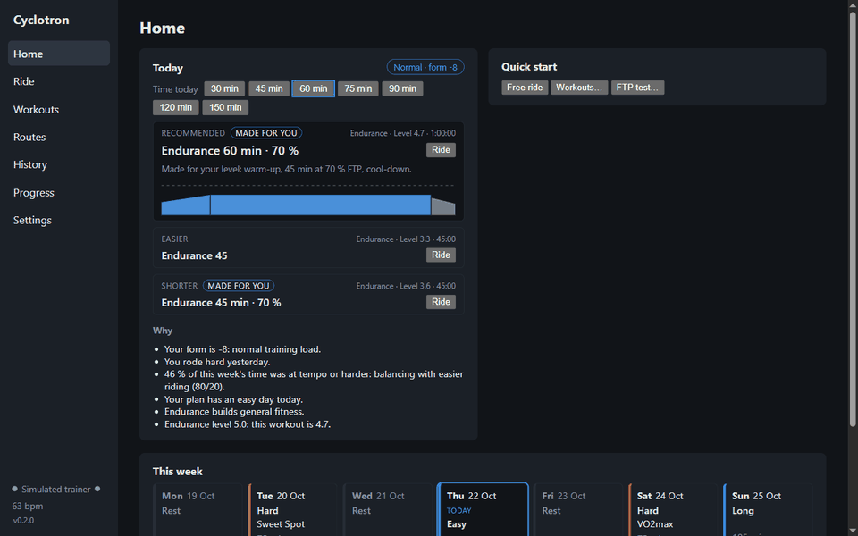
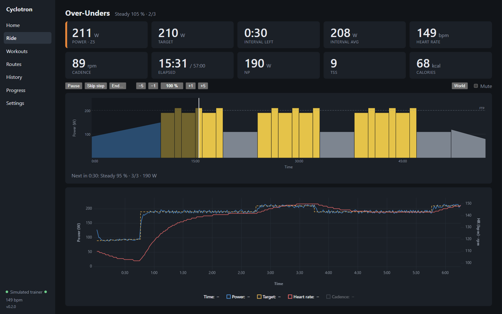
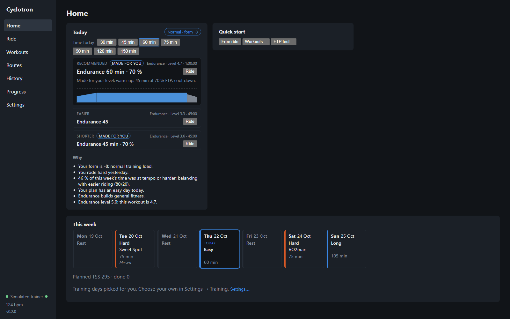
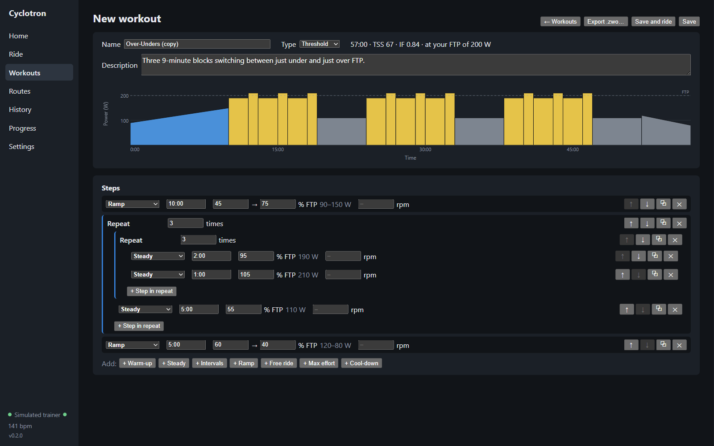
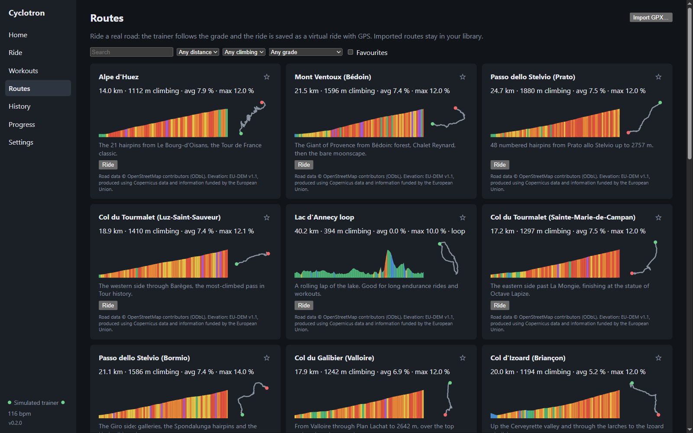
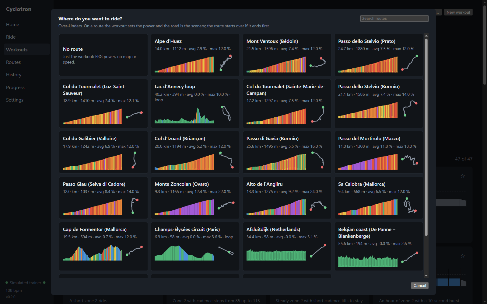
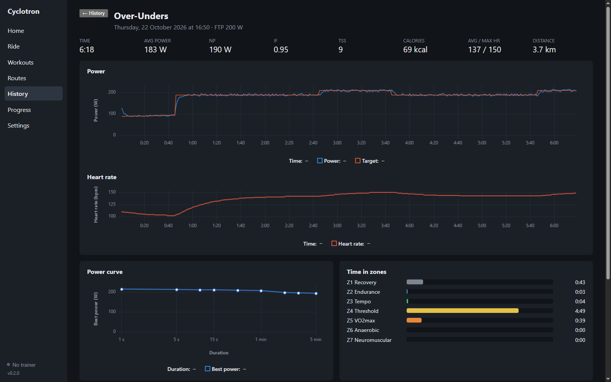

# Cyclotron

**A free, open-source indoor cycling trainer for your desktop: structured ERG workouts, a workout
recommended for today, virtual routes with a simple 3D view, FTP tests and FIT export, without a
subscription.**

Cyclotron connects to a smart trainer and a heart rate strap over Bluetooth and runs your
workouts in ERG mode: the trainer sets the resistance, you pedal. Every day it suggests a workout
that fits your training load and weekly plan, and tells you why.



> **Status: early (v0.2).** It is used for real rides on a Wahoo KICKR CORE 2 on Windows. Other
> FTMS trainers should work but haven't been tested. macOS builds are produced by CI but not yet
> tried on a Mac. Expect rough edges.

## Features

- **Recommended workouts**: a pick for today from your fitness, fatigue and form, recent rides,
  how hard workouts felt and your per-type levels, plus an easier and a shorter option. Each pick
  explains itself. Workouts can be generated to fit your level and the time you have.
- **Weekly plan**: hard, easy and long days spread over your training days, with planned vs done
  load and missed days.
- **Trainer control over Bluetooth FTMS**: ERG (target power), resistance mode, free ride,
  automatic reconnect, remembered devices. Trainers with only a Cycling Power service connect
  read-only. Heart rate from a BLE strap or relayed by the trainer.
- **Workouts**: 47 built-in workouts (recovery, endurance, tempo, sweet spot, threshold, VO2max,
  anaerobic) with levels 1–10, filters and favourites, a workout builder, and import of Zwift
  `.zwo` files.
- **Workout player**: pause, skip, intensity ±1/±5 %, countdown beeps (adjustable volume),
  next-step preview, and a live chart of power, target and heart rate.
- **Live metrics**: 3 s/10 s power, zones, average, Normalized Power, IF, TSS, calories, W/kg,
  interval average. You choose which tiles appear.
- **FTP tests**: ramp test (stops itself when you can't hold the target) and 20-minute test. The
  result can update your FTP, and every change is kept in an FTP history.
- **Virtual routes**: 22 built-in routes: climbs such as Alpe d'Huez, Mont Ventoux, Stelvio,
  Galibier, Tourmalet, Gavia, Mortirolo, Zoncolan, Angliru and Sa Calobra, and flat rides such as
  the Afsluitdijk, the Belgian coast, Regent's Park and Lac d'Annecy. You can import your own GPX.
  The trainer follows the grade (scaled by a difficulty setting), speed comes from a physics
  model, and the ride is saved as a virtual ride with GPS. You can also ride a workout on a route.
- **3D world**: an optional low-poly view of the route with terrain, trees, hairpins and gradient
  signs on climbs.
- **Progress**: fitness/fatigue/form chart, power curve, time in zones per week, FTP estimate,
  and ride details with charts and laps.
- **Zwift Play and Click controllers**: drive the whole app from the handlebars: the D-pad moves a
  highlight, A presses it, + / − change the watts, and the Ride screen shows which button does
  what. Both halves of a Zwift Play connect at once.
- **Garmin Connect** (optional): imports your other activities (runs, rides outside) into your
  training load, and sleep, HRV and resting heart rate into the daily recommendation. Rides go to
  Garmin with one click.
- **Strava** (optional): upload rides by hand or automatically after each ride.
- **Recording and export**: every ride is saved locally and written as a **FIT file** with laps.
  FIT files from other apps can be imported into your history.
- **Safe recording**: if the app or PC crashes mid-ride, you can continue the ride or save what
  was recorded on the next start. A long sleep or freeze pauses the ride instead of skipping
  ahead.
- **Offline and private**: no account and no cloud. Everything stays on your computer in one SQLite
  database; Garmin and Strava keys are stored encrypted.
- **English and Polish**, automatic updates on Windows, a diagnostic report for bug reports, and a
  **simulated trainer** for trying the app without a bike.















## How it compares

|         | Cyclotron                                       | Zwift                          | Auuki                              |
| ------- | ----------------------------------------------- | ------------------------------ | ---------------------------------- |
| Price   | Free, open source                               | Subscription                   | Free, open source                  |
| Runs as | Desktop app (Windows, macOS)                    | Desktop/mobile app             | Web app in the browser             |
| Focus   | Structured training, recommendations, FTP tests | Virtual worlds, racing, social | Structured training in the browser |
| World   | Simple 3D view of real routes                   | Full 3D worlds, other riders   | None                               |

If you prefer a browser app, [Auuki](https://github.com/dvmarinoff/Auuki) is a great project.
Cyclotron is a desktop app instead: it runs fully offline, keeps every ride in a local database,
and is built around structured training and choosing the right workout for the day.

## Install

Download the installer from the [Releases](https://github.com/wizzlerr/cyclotron/releases) page.

- **Windows 10/11**: run `Cyclotron-Setup-<version>.exe`. The installer is not code-signed yet, so
  SmartScreen warns: choose **More info → Run anyway**. Later versions install themselves on
  restart (Settings → About → Updates).
- **macOS**: open the `.dmg` and drag Cyclotron to Applications. The app is unsigned, so the first
  time you right-click it and choose **Open**. Allow Bluetooth when asked. The app tells you when a
  new version is out; download it from the Releases page.

You need a computer with Bluetooth Low Energy (most laptops; on desktops a USB BLE dongle works).
Keep it within a few metres of the trainer: connecting through walls is slow and unreliable.

## Quick start

1. **Settings → Profile**: enter your FTP (or run an FTP test first), weight and max heart rate.
2. **Settings → Trainer** and **Heart rate**: connect your trainer and strap. Cyclotron remembers
   them and reconnects on its own next time.
3. **Settings → Training**: your weekly hours, training days and goal, for the plan and the
   recommendations.
4. **Home**: pick how much time you have and press **Ride** on today's workout. Or choose any
   workout in **Workouts**, a route in **Routes**, or **Free ride**.
5. After the ride, the summary shows your laps and stats. The FIT file is in
   `Documents/Cyclotron` (change it in Settings).

### Garmin Connect

Settings → Garmin Connect: paste a Personal API key (from Garmin's developer portal). Cyclotron then reads
your other activities and daily wellness data every few hours. Wellness signals are used only
when the watch is worn all day. To send a ride to Garmin, press **Send to Garmin** in the ride
summary: it opens Garmin's import page and the FIT file.

### Strava

Strava needs your own API application: create one at
[strava.com/settings/api](https://www.strava.com/settings/api) with `localhost` as the
authorization callback domain, then paste its Client ID and Client Secret in Settings → Strava and
press **Connect**. Rides can then be uploaded from the summary, or automatically.

### Zwift controllers

Settings → Controllers → **Add controller…**, then pick the controller in the list. A Zwift Play is
two devices with the same name: add both. Each one is shown with the last 4 characters of its
address (for example "Zwift Play 0523"), and the card has a tester that shows every press.
Don't pick your trainer: the KICKR CORE 2 also offers the Zwift service, and Cyclotron refuses it.

| Button                                  | Does                                                              |
| --------------------------------------- | ----------------------------------------------------------------- |
| D-pad                                   | Moves the highlight between tabs, buttons and settings            |
| A                                       | Presses the highlighted item                                      |
| B                                       | Closes a dialog or clears the highlight                           |
| + / − (side buttons, Click, paddles)    | ERG ±10 W, workout intensity ±1 %, resistance ±5 %                |
| Ride screen, nothing highlighted: A     | Start, pause, resume                                              |
| Ride screen, nothing highlighted: B     | ERG on/off in a free ride                                         |
| Ride screen: Y / Z                      | Mute the beeps / show or hide the 3D world                        |

On the Ride screen the highlight fades after 5 seconds, so A goes back to start/pause, and each
control shows its button as a coloured badge.

### Problems?

Settings → Problem? saves a diagnostic report (app log and Bluetooth trace, no keys or tokens)
that you can attach to a [GitHub issue](https://github.com/wizzlerr/cyclotron/issues).

## Supported hardware

| Device                        | Status                                                               |
| ----------------------------- | -------------------------------------------------------------------- |
| Wahoo KICKR CORE 2            | Tested (FTMS, firmware 3.5.11): ERG, resistance, grade               |
| Other FTMS smart trainers     | Should work (Tacx, Elite, Saris, Wahoo, …); reports welcome          |
| Cycling Power only (CPS)      | Read-only: power, cadence and speed, no control                      |
| BLE heart rate straps         | Standard Heart Rate service (tested with a Polar H10)                |
| Zwift Play / Ride / Click     | Zwift Play (both halves) and Click tested; Ride from the protocol    |
| ANT+ only devices             | Not supported                                                        |

## Build from source

Requirements: [Node.js](https://nodejs.org/) 24+ and [pnpm](https://pnpm.io/) 12+.

```sh
pnpm install
pnpm dev          # run the app with hot reload
pnpm test         # unit tests (Vitest)
pnpm typecheck
pnpm lint
pnpm dist         # Windows installer → apps/desktop/dist/
pnpm --filter @cyclotron/desktop dist:mac   # macOS .dmg (run on a Mac)
```

Releases are built by GitHub Actions when a `v*` tag is pushed (`.github/workflows/release.yml`).
Code signing switches on when the signing secrets are set.

## Project layout

```
packages/core     Pure TypeScript: BLE parsing, workout model and player, training math,
                  recommendations, weekly plan, routes and world geometry, FIT encoding
                  and decoding. No I/O, fully unit-tested.
apps/desktop      Electron + Svelte 5 app (electron-vite). Main process: SQLite, files,
                  Bluetooth device picker, Garmin, Strava, updates. Renderer: UI, trainer
                  control, recording, 3D world (Three.js).
```

The design and its decisions (with the alternatives that were rejected) are in
[DESIGN.md](DESIGN.md). The roadmap with task IDs is in [BACKLOG.md](BACKLOG.md).

## Roadmap

- **Mac testing and signed builds** for Windows and macOS.
- **Self-hosted sync server** and **cloud-folder sync** between computers: planned, built when
  there is demand.

## Route data

The built-in routes are generated by `scripts/build-routes.mjs` from open data: road geometry ©
[OpenStreetMap](https://www.openstreetmap.org/copyright) contributors (ODbL 1.0), routed with
[OSRM](https://project-osrm.org/), and elevation from EU-DEM v1.1 via
[OpenTopoData](https://www.opentopodata.org/), produced using Copernicus data and information
funded by the European Union.

## Contributing

Issues and pull requests are welcome. Trainer and controller compatibility reports (model,
firmware, what worked) are especially useful. Before sending code:

```sh
pnpm test && pnpm typecheck && pnpm lint && pnpm format:check
```

Keep `packages/core` free of I/O and covered by tests. User-facing text goes in both English and
Polish (`apps/desktop/src/renderer/src/i18n/messages/`).

## Disclaimer

Cyclotron is an independent project, not affiliated with Zwift, Wahoo, Garmin, Strava or any other
company named here. Their names are trademarks of their owners. Ride safely and within your limits.

## License

[GNU Affero General Public License v3.0](LICENSE) or later. You may use, change and share
Cyclotron as long as the source of your version stays available under the same license.
