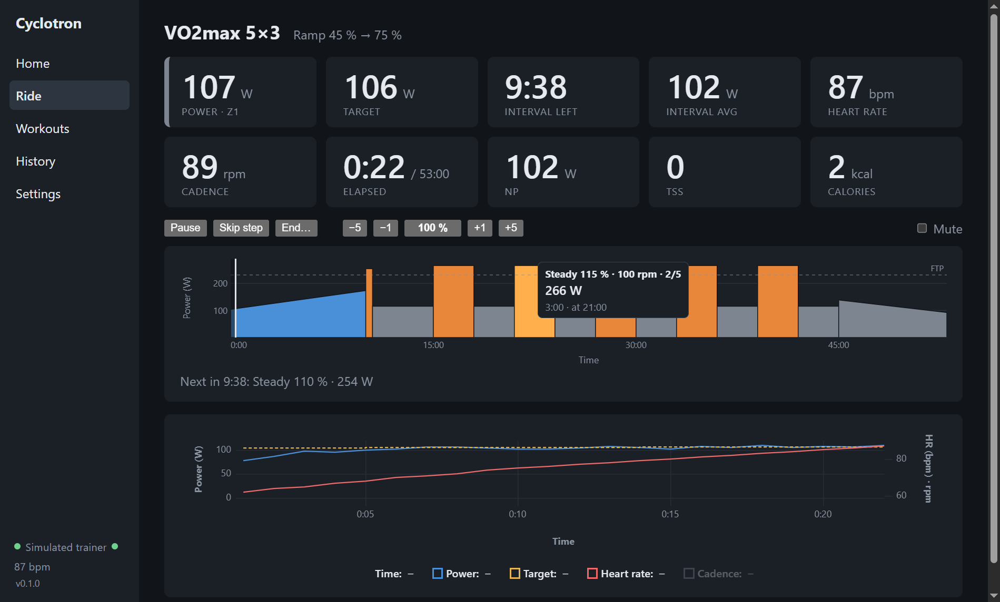
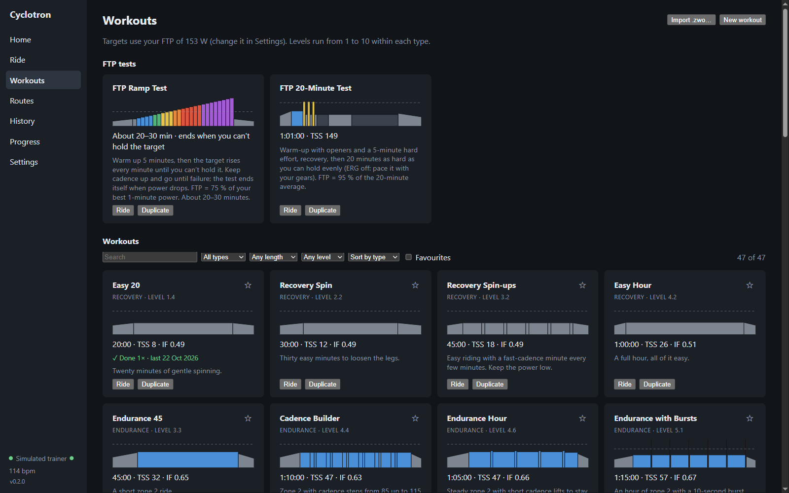

# Cyclotron

**A free, open-source indoor cycling trainer for your desktop: structured ERG workouts, live
metrics, FTP tests and FIT export, without a subscription or a 3D world.**

Cyclotron connects to a smart trainer and a heart rate strap over Bluetooth and runs your
workouts in ERG mode: the trainer sets the resistance, you pedal. Think "Zwift without the
graphics", aimed at riders who mainly do structured training.



> **Status: early (v0.1).** It is used for real rides on a Wahoo KICKR CORE 2 on Windows. Other
> FTMS trainers should work but haven't been tested. macOS builds are configured but not yet
> tried. Expect rough edges.

## Features

- **Trainer control over Bluetooth FTMS**: ERG (target power), free ride, automatic reconnect,
  remembered devices. Heart rate from a BLE strap or relayed by the trainer.
- **Workouts**: built-in workouts (recovery, endurance, sweet spot, threshold, VO2max), and
  import of Zwift `.zwo` files. Each workout shows a profile coloured by power zone; hover a step to
  see its watts.
- **Workout player**: pause, skip, intensity ±1/±5 %, countdown beeps, next-step preview, and a
  live chart of power, target and heart rate.
- **Live metrics**: 3 s/10 s power, zones, average, Normalized Power, IF, TSS, calories, W/kg,
  interval average. You choose which tiles appear.
- **FTP tests**: ramp test (stops itself when you can't hold the target) and 20-minute test. The
  result can update your FTP, and every change is kept in an FTP history.
- **Virtual routes**: 22 built-in routes: climbs such as Alpe d'Huez, Mont Ventoux, Stelvio,
  Galibier, Tourmalet, Gavia, Mortirolo, Zoncolan, Angliru and Sa Calobra, and flat rides for
  endurance and workouts: the Afsluitdijk, the Belgian coast, Regent's Park, Strandvejen, the Bay
  of Alcúdia, Lac d'Annecy and the Champs-Élysées. You can also import your own GPX. The trainer follows the grade (scaled by a difficulty setting),
  speed comes from a physics model, and the ride is saved as a virtual ride with GPS. You can also
  ride a workout on a route.
- **Recording and export**: every ride is saved locally and written as a **FIT file** with
  laps. Import it into Garmin Connect, Strava, intervals.icu, etc.
- **Safe recording**: if the app or PC crashes mid-ride, the ride is recovered on the next start. A
  long sleep or freeze pauses the ride instead of skipping ahead.
- **Offline and private**: no account and no cloud. Everything stays on your computer in one SQLite
  database.
- **Simulated trainer** for trying the app without a bike.



## How it compares

|                              | Cyclotron                                 | Zwift                           | Auuki                                  |
| ---------------------------- | ----------------------------------------- | ------------------------------- | -------------------------------------- |
| Price                        | Free, open source                         | Subscription                    | Free, open source                      |
| Runs as                      | Desktop app (Windows, macOS)              | Desktop/mobile app              | Web app in the browser                 |
| Focus                        | Structured ERG training, FTP tests        | Virtual worlds, racing, social  | Structured training in the browser     |

If you prefer a browser app, [Auuki](https://github.com/dvmarinoff/Auuki) is a great project.
Cyclotron is a desktop app instead: it runs fully offline, keeps every ride in a local database,
and is built around structured training. Next up is recommending today's workout from your
training load (see the roadmap).

## Install

Installers will be published on the [Releases](https://github.com/wizzlerr/cyclotron/releases)
page. Until then, build one yourself (below).

- **Windows 10/11**: run `Cyclotron-Setup-<version>.exe`. The installer is not code-signed yet, so
  SmartScreen warns: choose **More info → Run anyway**.
- **macOS**: open the `.dmg` and drag Cyclotron to Applications. The app is unsigned, so the first
  time you right-click it and choose **Open**. Allow Bluetooth when asked.

You need a computer with Bluetooth Low Energy (most laptops; on desktops a USB BLE dongle works).
Keep it within a few metres of the trainer: connecting through walls is slow and unreliable.

## Quick start

1. **Settings → Profile**: enter your FTP (or run an FTP test first), weight and max heart rate.
2. **Settings → Trainer** and **Heart rate**: connect your trainer and strap. Cyclotron remembers
   them and reconnects on its own next time.
3. **Workouts**: pick a workout and press **Ride**, then **Start**. Or use **Free ride** on Home.
4. After the ride, the summary shows your laps and stats. The FIT file is in
   `Documents/Cyclotron` (change it in Settings).

## Supported hardware

| Device                     | Status                                                           |
| -------------------------- | ---------------------------------------------------------------- |
| Wahoo KICKR CORE 2         | Tested (FTMS, firmware 3.5.11)                                   |
| Other FTMS smart trainers  | Should work (Tacx, Elite, Saris, Wahoo, …); reports welcome      |
| BLE heart rate straps      | Standard Heart Rate service (tested with a Polar H10)            |
| ANT+ only devices          | Not supported                                                    |

## Build from source

Requirements: [Node.js](https://nodejs.org/) 24+ and [pnpm](https://pnpm.io/) 12+.

```sh
pnpm install
pnpm dev          # run the app with hot reload
pnpm test         # unit tests (Vitest)
pnpm typecheck
pnpm lint
pnpm dist         # Windows installer → apps/desktop/dist/
pnpm --filter @cyclotron/desktop dist:mac   # macOS .dmg (run on a Mac)
```

## Project layout

```
packages/core     Pure TypeScript: BLE parsing, workout model and player, training math,
                  FIT encoding. No I/O, fully unit-tested.
apps/desktop      Electron + Svelte 5 app (electron-vite). Main process: SQLite, files,
                  Bluetooth device picker. Renderer: UI, trainer control, recording.
```

The design and its decisions (with the alternatives that were rejected) are in
[DESIGN.md](DESIGN.md). The roadmap with task IDs is in [BACKLOG.md](BACKLOG.md).

## Roadmap

- **Self-hosted sync server**: a small Docker container (for example on a NAS) that keeps your
  history and powers analytics.
- **Recommended workouts**: picks for today based on your training load, recent rides and how
  hard workouts felt, with an explanation for each pick.
- **Garmin Connect**: automatic ride upload and import of metrics such as VO2max and readiness.

## Route data

The built-in routes are generated by `scripts/build-routes.mjs` from open data: road geometry ©
[OpenStreetMap](https://www.openstreetmap.org/copyright) contributors (ODbL 1.0), routed with
[OSRM](https://project-osrm.org/), and elevation from EU-DEM v1.1 via
[OpenTopoData](https://www.opentopodata.org/), produced using Copernicus data and information
funded by the European Union.

## Contributing

Issues and pull requests are welcome. Trainer compatibility reports (model, firmware, what
worked) are especially useful. Before sending code:

```sh
pnpm test && pnpm typecheck && pnpm lint && pnpm format:check
```

Keep `packages/core` free of I/O and covered by tests.

## Disclaimer

Cyclotron is an independent project, not affiliated with Zwift, Wahoo, Garmin, Strava or any other
company named here. Their names are trademarks of their owners. Ride safely and within your limits.

## License

[GNU Affero General Public License v3.0](LICENSE) or later. You may use, change and share
Cyclotron, including the planned sync server, as long as the source of your version stays
available under the same license.
